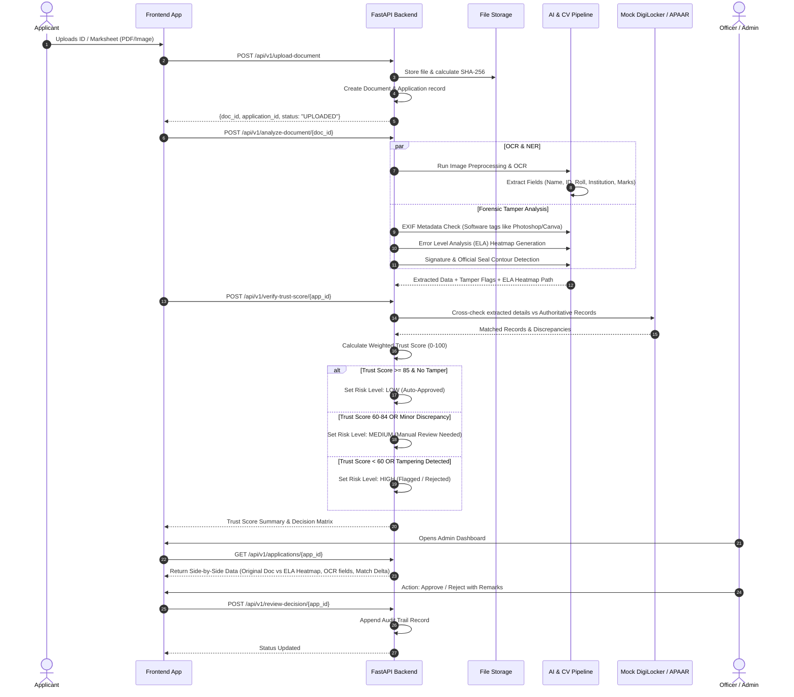

# AI-Powered Application Validation and Document Authentication (SIH26261)

## System Architecture Blueprint

```mermaid
flowchart TD
    subgraph ClientLayer ["Client Applications"]
        AP["Applicant Portal (React)"]
        AD["Admin Review Dashboard (React)"]
    end

    subgraph APIGateway ["API & Orchestration Layer (FastAPI)"]
        EP_UP["/api/v1/upload-document\n(Validation & SHA-256 Hashing)"]
        EP_AN["/api/v1/analyze-document\n(OCR, NER & Forensic Pipeline)"]
        EP_VR["/api/v1/verify-trust-score\n(Registry Cross-Check & Scoring)"]
        EP_AD["/api/v1/review-decision\n(Admin Audit & Overrides)"]
    end

    subgraph AIPipeline ["AI Verification & Forensic Engine"]
        subgraph OCR_NER ["OCR & NER Subsystem"]
            PRE["Image Pre-processing\n(Deskew, Grayscale, Denoise)"]
            OCR["OCR Engine\n(Tesseract / EasyOCR / LayoutLM)"]
            NER["Rule & Regex Layout NER\n(Aadhaar, PAN, Roll No, CGPA)"]
        end

        subgraph Forensic ["Computer Vision Tamper Detection"]
            EXIF["EXIF & Metadata Forensics\n(Editing Software Flags, Timestamps)"]
            ELA["Error Level Analysis (ELA)\n(JPEG Compression Differential Heatmap)"]
            EDGE["Edge & Splicing Detector\n(Laplacian Gradient Variance)"]
            STAMP["Stamp & Signature Detector\n(Color Masking & Contour Segmentation)"]
        end
    end

    subgraph VerificationEngine ["Trust & Cross-Verification Layer"]
        MOCK_DL["DigiLocker Mock Service\n(Identity Credential Verification)"]
        MOCK_AP["APAAR / ABC Mock Service\n(Academic Bank of Credits Verification)"]
        FUZZY["Fuzzy String & Levenshtein Matcher\n(Name, Institution, Passing Year)"]
        TRUST_ENGINE["Multi-Factor Trust Scoring Engine\n(Weights: 40% Forensic + 20% OCR + 40% Registry)"]
    end

    subgraph StorageLayer ["Persistence & Storage"]
        DB[(PostgreSQL / SQLite Database)]
        BLOB[Local Storage / S3 Bucket\n(Raw Docs + ELA Heatmap Artifacts)]
    end

    %% Flow Connections
    AP -->|1. Multipart Upload| EP_UP
    EP_UP -->|Save File & Hash| BLOB
    EP_UP -->|Record Metadata| DB

    EP_UP -->|2. Trigger Analysis| EP_AN
    EP_AN --> PRE --> OCR --> NER
    EP_AN --> EXIF & ELA & EDGE & STAMP
    ELA -->|Save Anomaly Heatmap| BLOB

    EP_AN -->|3. Trigger Verification| EP_VR
    EP_VR --> MOCK_DL & MOCK_AP
    MOCK_DL & MOCK_AP --> FUZZY
    FUZZY --> TRUST_ENGINE
    TRUST_ENGINE -->|Risk Category: LOW / MED / HIGH| DB

    AD -->|4. Inspect Queue & Side-by-Side Review| EP_AD
    EP_AD -->|Query Doc, ELA Heatmap, Flags| DB
    EP_AD -->|Fetch Visuals| BLOB
    AD -->|5. Approve / Reject with Audit Trail| EP_AD
```

---

## High-Level Verification Pipeline Sequence



---

## Multi-Factor Trust Scoring Formula

$$\text{Trust Score} = w_{\text{forensic}} \cdot S_{\text{forensic}} + w_{\text{ocr}} \cdot S_{\text{ocr}} + w_{\text{registry}} \cdot S_{\text{registry}}$$

Where:
- $w_{\text{forensic}} = 0.40$: Error Level Analysis residual variance, absence of editing software in EXIF, continuous edge density, verified seal presence.
- $w_{\text{ocr}} = 0.20$: Confidence scores of OCR engine across essential identity and credential fields.
- $w_{\text{registry}} = 0.40$: Fuzzy string similarity (Token Sort Ratio & Levenshtein) against mock DigiLocker/APAAR databases.

### Risk Stratification Matrix:
| Score Range | Risk Tier | Automated Workflow Action |
| :--- | :--- | :--- |
| **85 – 100** | **LOW RISK** | **Auto-Approve** (Fast-track admission / recruitment) |
| **60 – 84** | **MEDIUM RISK** | **Manual Review** (Dispatched to officer dashboard with flagged anomalies) |
| **0 – 59** | **HIGH RISK** | **Immediate Flag / Rejection** (Tamper detected or critical registry mismatch) |
