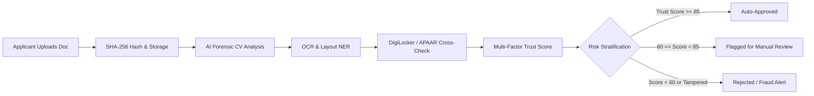

# SatyaPramaan AI — AI-Powered Application Validation & Document Authentication
### Smart India Hackathon Problem Statement SIH26261 Prototype

**SatyaPramaan AI** is a production-grade, end-to-end prototype engineered for **Smart India Hackathon (SIH26261)**. It provides automated document fraud detection, multi-modal OCR entity extraction, authoritative government registry cross-verification (DigiLocker & APAAR), and an automated multi-factor Trust Scoring matrix with an interactive officer review dashboard.

---

## 1. System Architecture & Repository Structure

```
d:\SIH-26\PS2\
├── ARCHITECTURE.md                  # High-level architecture blueprint & Mermaid flowcharts
├── README.md                        # Complete project documentation & execution guide
├── backend/
│   ├── requirements.txt             # Python backend dependencies
│   ├── seed_data.py                 # Multi-scenario database seeder (Clean, Borderline, Tampered)
│   ├── uploads/                     # Document store
│   │   ├── forensics/               # Error Level Analysis (ELA) generated heatmaps
│   │   └── ...                      # Uploaded certificates & identity documents
│   └── app/
│       ├── __init__.py
│       ├── main.py                  # FastAPI application entrypoint with CORS & static mounts
│       ├── config.py                # Environment configs & trust score weights
│       ├── database.py              # SQLAlchemy engine & SQLite/Postgres session factory
│       ├── models/
│       │   ├── __init__.py
│       │   └── application.py       # ORM models (Applications, Documents, ExtractedFields, etc.)
│       ├── schemas/
│       │   ├── __init__.py
│       │   └── application.py       # Pydantic v2 validation models
│       ├── utils/
│       │   ├── __init__.py
│       │   └── file_storage.py      # Async file saving & SHA-256 cryptographic hashing
│       ├── services/
│       │   ├── __init__.py
│       │   ├── forensics_service.py # CV Forensics (EXIF, ELA heatmap, Stamp & Signature segmentation)
│       │   ├── ocr_service.py       # OCR & Regex Layout NER for Indian IDs & Marksheets
│       │   ├── digilocker_mock.py   # DigiLocker & APAAR authoritative registry simulation
│       │   └── trust_score_service.py # Multi-factor weighted Trust Scoring & Risk Engine
│       └── api/
│           ├── __init__.py
│           └── endpoints.py         # REST API routes (/upload, /analyze, /verify, /review)
└── frontend/
    ├── package.json
    ├── vite.config.js               # Proxy setup to port 8000
    ├── index.html                   # HTML template with Google Fonts (Outfit & Inter)
    └── src/
        ├── index.css                # Glassmorphic design system tokens
        ├── App.jsx                  # Main application state & tab orchestration
        ├── main.jsx
        └── components/
            ├── Navbar.jsx           # Header & live backend health monitor
            ├── ApplicantPortal.jsx  # Drag-and-drop upload, live preview, pipeline stepper
            ├── AdminDashboard.jsx   # Side-by-side inspector with interactive ELA cross-fade slider
            └── RegistryExplorer.jsx # DigiLocker & APAAR mock database viewer
```

---

## 2. Core Functional Workflow



### 1. Computer Vision Forensic Engine
- **EXIF Metadata Forensics:** Scans for digital editing software footprints (`Adobe Photoshop`, `Canva`, `GIMP`, `PicsArt`) and timestamp discrepancies between digitized and modified dates.
- **Error Level Analysis (ELA):** Analyzes JPEG compression artifacts by re-saving at 90% quality and amplifying the difference matrix ($15\times$). Uniform images reflect authentic documents, while digital splices/patches exhibit high variance and produce an informative colorized heatmap overlay.
- **Official Stamp & Seal Detection:** Uses HSV color thresholding (red, purple, and blue ink zones) to segment official institutional stamps and verify issuing authority credentials.
- **Signatory Stroke Contour Analysis:** Identifies handwritten signature pen strokes in the designated signatory regions.
- **Edge Gradient Splicing:** Evaluates Laplacian variance across an $8\times 8$ block grid to detect gradient boundaries around pasted text boxes.

### 2. Multi-Modal OCR & Layout NER
- Pre-processes documents using bilateral filtering and Otsu's adaptive binarization.
- Extracts key fields across Indian identity and academic credentials:
  - **Aadhaar UID:** 12-digit format (`\d{4} \d{4} \d{4}`)
  - **PAN Card:** 10-character alphanumeric structure (`[A-Z]{5}[0-9]{4}[A-Z]{1}`)
  - **Academic Credentials:** Roll Number, Candidate Name, Institution, Passing Year, CGPA/Percentage.

### 3. Authoritative Registry Simulator (DigiLocker & APAAR)
- Cross-validates extracted fields against authoritative mock databases simulating:
  - **DigiLocker UIDAI:** Citizen Aadhaar demographic records.
  - **DigiLocker Income Tax:** Verified PAN database.
  - **APAAR (Academic Bank of Credits):** University enrollment registries, verified CGPA, and revocation records.
- Utilizes token-sort fuzzy matching and Levenshtein distance metrics to account for acceptable minor name order differences while catching grade/CGPA alterations or counterfeit IDs.

### 4. Multi-Factor Trust Scoring Formula

$$\text{Trust Score} = 0.40 \times S_{\text{forensic}} + 0.20 \times S_{\text{ocr}} + 0.40 \times S_{\text{registry}} - P_{\text{cross\_doc}}$$

- **LOW RISK ($\ge 85$):** Auto-Approve candidate.
- **MEDIUM RISK ($60 - 84$):** Dispatched to officer review queue with highlighted fields.
- **HIGH RISK ($< 60$ or Tamper Flag):** Flagged for immediate scrutiny or automated rejection.

---

## 3. Database Schema

The prototype utilizes an SQLAlchemy ORM database with SQLite (or PostgreSQL via `DATABASE_URL`):

```sql
-- Applications Table
CREATE TABLE applications (
    id VARCHAR(36) PRIMARY KEY,
    applicant_name VARCHAR(150) NOT NULL,
    applicant_email VARCHAR(150) NOT NULL,
    applicant_phone VARCHAR(20),
    status VARCHAR(30) DEFAULT 'PENDING',       -- PENDING, AUTO_APPROVED, MANUAL_REVIEW, REJECTED
    risk_level VARCHAR(20) DEFAULT 'UNKNOWN',    -- LOW, MEDIUM, HIGH
    trust_score FLOAT DEFAULT 0.0,
    decision_remarks TEXT,
    created_at DATETIME,
    updated_at DATETIME
);

-- Documents Table
CREATE TABLE documents (
    id VARCHAR(36) PRIMARY KEY,
    application_id VARCHAR(36) REFERENCES applications(id) ON DELETE CASCADE,
    doc_type VARCHAR(50) NOT NULL,              -- MARKSHEET, DEGREE_CERTIFICATE, AADHAAR_CARD, PAN_CARD
    original_filename VARCHAR(255) NOT NULL,
    stored_filename VARCHAR(255) NOT NULL,
    file_path VARCHAR(500) NOT NULL,
    mime_type VARCHAR(100) NOT NULL,
    file_size INTEGER DEFAULT 0,
    sha256_hash VARCHAR(64) NOT NULL,           -- Cryptographic tamper-evidence
    status VARCHAR(30) DEFAULT 'UPLOADED',
    is_tampered BOOLEAN DEFAULT FALSE,
    tamper_summary TEXT,
    created_at DATETIME
);

-- Extracted Fields (OCR & NER)
CREATE TABLE extracted_fields (
    id INTEGER PRIMARY KEY AUTOINCREMENT,
    document_id VARCHAR(36) REFERENCES documents(id) ON DELETE CASCADE,
    field_name VARCHAR(100) NOT NULL,           -- APPLICANT_NAME, ROLL_NUMBER, CGPA_OR_MARKS, etc.
    field_value TEXT NOT NULL,
    confidence FLOAT DEFAULT 100.0,
    bounding_box JSON,                          -- [x, y, width, height]
    is_matched BOOLEAN DEFAULT FALSE
);

-- Forensic Reports (Computer Vision & ELA)
CREATE TABLE forensic_reports (
    id INTEGER PRIMARY KEY AUTOINCREMENT,
    document_id VARCHAR(36) REFERENCES documents(id) ON DELETE CASCADE UNIQUE,
    exif_software VARCHAR(150),
    exif_tamper_flag BOOLEAN DEFAULT FALSE,
    ela_discrepancy_score FLOAT DEFAULT 0.0,
    ela_heatmap_path VARCHAR(500),
    edge_noise_variance FLOAT DEFAULT 0.0,
    stamp_seal_detected BOOLEAN DEFAULT FALSE,
    stamp_seal_confidence FLOAT DEFAULT 0.0,
    signature_detected BOOLEAN DEFAULT FALSE,
    signature_confidence FLOAT DEFAULT 0.0,
    splicing_detected BOOLEAN DEFAULT FALSE,
    forensic_score FLOAT DEFAULT 100.0,
    anomaly_flags JSON,
    summary TEXT,
    created_at DATETIME
);

-- Registry Verifications (DigiLocker / APAAR)
CREATE TABLE registry_verifications (
    id INTEGER PRIMARY KEY AUTOINCREMENT,
    document_id VARCHAR(36) REFERENCES documents(id) ON DELETE CASCADE,
    registry_name VARCHAR(100) NOT NULL,        -- DIGILOCKER_AADHAAR, APAAR_EDUCATION, etc.
    matched_status VARCHAR(50) DEFAULT 'UNVERIFIED', -- MATCHED, PARTIAL_MATCH, FRAUD_MISMATCH
    match_score FLOAT DEFAULT 0.0,
    queried_key VARCHAR(150),
    registry_record_preview JSON,
    discrepancy_details TEXT,
    verified_at DATETIME
);

-- Audit Trails (Immutable Historical Log)
CREATE TABLE audit_trails (
    id INTEGER PRIMARY KEY AUTOINCREMENT,
    application_id VARCHAR(36) REFERENCES applications(id) ON DELETE CASCADE,
    action VARCHAR(100) NOT NULL,
    performed_by VARCHAR(100) DEFAULT 'SYSTEM_AI',
    details TEXT,
    timestamp DATETIME
);
```

---

## 4. API Reference

### Document Upload
- **`POST /api/v1/upload-document`**
  - **Body (Multipart Form):** `application_id`, `doc_type`, `file`
  - **Response:**
    ```json
    {
      "message": "Document uploaded successfully",
      "document_id": "84f7a9be-2ac4-4133-8e66-530e717e173d",
      "application_id": "89990224-e2ca-4fd0-9fab-8a9fa3ef5b36",
      "doc_type": "MARKSHEET",
      "sha256_hash": "10ff2bb383d2498d8fc6bed3eb9f750399f6d7f667a464e1d8fec1fe03f5b7ef",
      "file_url": "/uploads/doc_aarav_marksheet.jpg",
      "status": "UPLOADED"
    }
    ```

### Analyze Document (AI Forensics & OCR)
- **`POST /api/v1/analyze-document/{doc_id}`**
  - Generates ELA heatmap, inspects EXIF, detects stamps and signatures, parses layout tokens.
  - **Response:**
    ```json
    {
      "document_id": "84f7a9be-...",
      "status": "ANALYZED",
      "is_tampered": false,
      "forensic_report": {
        "forensic_score": 100.0,
        "exif_software": "Digital Identity Scanner v3.2",
        "exif_tamper_flag": false,
        "ela_discrepancy_score": 31.38,
        "ela_heatmap_url": "/uploads/forensics/ela_doc_aarav_marksheet.jpg",
        "stamp_seal_detected": true,
        "signature_detected": true,
        "anomaly_flags": []
      },
      "extracted_fields": [
        { "field_name": "APPLICANT_NAME", "field_value": "Aarav Sharma", "confidence": 95.0 },
        { "field_name": "ROLL_NUMBER", "field_value": "2020CS1049", "confidence": 94.0 },
        { "field_name": "CGPA_OR_MARKS", "field_value": "8.92", "confidence": 93.5 }
      ]
    }
    ```

### Registry Verification & Trust Score
- **`POST /api/v1/verify-document/{doc_id}`**
  - Queries mock DigiLocker or APAAR repository and returns match status and discrepancy breakdown.
- **`POST /api/v1/verify-trust-score/{app_id}`**
  - Evaluates multi-factor formula and assigns `LOW`, `MEDIUM`, or `HIGH` risk tier.
- **`POST /api/v1/review-decision/{app_id}`**
  - Records officer manual override (Approve / Reject) with immutable audit trail.

---

## 5. How to Run Locally

### Prerequisites
- Python 3.10+
- Node.js 18+

### Step 1: Start Backend
```powershell
cd d:\SIH-26\PS2\backend

# Activate virtual environment
.\.venv\Scripts\activate

# Pre-populate sample test scenarios (Genuine, Borderline, Photoshop Forgery)
python seed_data.py

# Launch FastAPI microservice
python -m uvicorn app.main:app --host 127.0.0.1 --port 8000 --reload
```
- Interactive API Docs (Swagger UI): `http://127.0.0.1:8000/docs`

### Step 2: Start Frontend
```powershell
cd d:\SIH-26\PS2\frontend

# Install dependencies (already installed in workspace)
npm install

# Run Vite dev server
npm run dev
```
- Open Browser: `http://localhost:5173/`
